# SIGSF · Manual de Usuario

**Versión 3.0** · Corresponde a la versión **5.4.0** del sistema  
Sistema Integral de Gestión de Servicios Financieros · Curso Integrador I Sistemas - Software (UTP)

## Historial de versiones

| Fecha | Versión | Elaborado por | Descripción | Revisado por | Fecha de revisión |
|---|---|---|---|---|---|
| 15/05/2024 | 1.0 | | Versión preliminar como propuesta. | Rene Alonso Nieto Valencia | 15/05/2024 |
| 25/10/2026 | 2.0 | Equipo SIGSF | Actualización a la versión 5.0.1 del sistema: instalación con Git y scripts de BD, seguridad, importación y exportación de ficheros, respaldos y auditoría, pantalla Control de versiones, anexo de Git/GitHub y solución de problemas. | | |
| 28/10/2026 | 3.0 | Equipo SIGSF | Actualización a la versión 5.4.0 del sistema: pagos con QR (Yape, Plin y Tunki), cotizaciones, módulo Pagos y cobranzas, documentos imprimibles, interfaz Bootstrap 5, capa animada y fondo animado; matriz de permisos y solución de problemas actualizadas. | | |

## Índice

- [1. PRESENTACIÓN](#1-presentación)
  - [1.1. DESCRIPCIÓN DE LA APLICACIÓN.](#11-descripción-de-la-aplicación)
  - [1.2. REQUISITOS MÍNIMOS.](#12-requisitos-mínimos)
  - [1.3. PUNTO DE INICIO PARA LA INSTALACIÓN Y CONFIGURACIÓN.](#13-punto-de-inicio-para-la-instalación-y-configuración)
  - [1.4. INSTALACIÓN.](#14-instalación)
  - [1.5. CONFIGURACIÓN.](#15-configuración)
  - [1.6. OTROS.](#16-otros)
- [2. MÓDULO DE USUARIO ESTÁNDAR](#2-módulo-de-usuario-estándar)
  - [2.1. ESTRUCTURA VISUAL](#21-estructura-visual)
  - [2.2. FUNCIONALIDADES](#22-funcionalidades)
- [3. MÓDULO DE USUARIO ADMINISTRACIÓN](#3-módulo-de-usuario-administración)
  - [3.1. ESTRUCTURA VISUAL.](#31-estructura-visual)
  - [3.2. FUNCIONALIDADES.](#32-funcionalidades)
  - [3.3. PERMISOS POR ROL.](#33-permisos-por-rol)
  - [3.4. IMPORTACIÓN Y EXPORTACIÓN DE FICHEROS.](#34-importación-y-exportación-de-ficheros)
  - [3.5. RESPALDOS Y AUDITORÍA.](#35-respaldos-y-auditoría)
  - [3.6. CONTROL DE VERSIONES (PANTALLA DEL SISTEMA).](#36-control-de-versiones-pantalla-del-sistema)
- [4. CONTROL DE VERSIONES DEL PROYECTO (GIT Y GITHUB)](#4-control-de-versiones-del-proyecto-git-y-github)
  - [4.1. RAMAS Y VERSIONES.](#41-ramas-y-versiones)
  - [4.2. FLUJO DE TRABAJO DIARIO.](#42-flujo-de-trabajo-diario)
- [5. SOLUCIÓN DE PROBLEMAS FRECUENTES](#5-solución-de-problemas-frecuentes)

---

# 1. PRESENTACIÓN

## 1.1. DESCRIPCIÓN DE LA APLICACIÓN.

SIGSF (Sistema Integral de Gestión de Servicios Financieros) es una aplicación web desarrollada en Java para el curso Integrador I Sistemas - Software de la UTP. Permite administrar las operaciones de una entidad financiera que ofrece servicios de banco, casa de cambio y casa de empeño, e incluye además un portal público donde el propio cliente puede autoatenderse. Esta **versión 2.0 del manual** corresponde a la **versión 5.0.1** del sistema, que incorpora seguridad reforzada, importación y exportación de ficheros, respaldos con bitácora de auditoría y un sistema de control de versiones con Git.

El sistema está organizado en capas: el navegador consume una API REST publicada por un servidor HTTP propio de Java (ApiServer, basado en com.sun.net.httpserver); los controladores (uno por módulo) reciben las peticiones y las derivan a la capa de servicio, donde viven las reglas de negocio y las validaciones; la capa de servicio usa DAO con SQL escrito a mano (JDBC) para leer y escribir en PostgreSQL (base de datos de 34 tablas). El mismo servidor sirve también los archivos del frontend (HTML, CSS y JavaScript de la carpeta web/), de modo que todo el sistema funciona desde una sola URL, sin problemas de CORS.

La aplicación tiene dos frentes claramente diferenciados:

- **Sistema interno (personal):** panel administrativo con todos los módulos de gestión, para el personal con rol Administrador, Supervisor, Cajero o Analista. Cada rol ve y modifica únicamente lo que su permiso le autoriza.
- **Portal del Cliente:** sitio independiente donde el cliente crea su cuenta, inicia sesión con su número de documento y solicita sus trámites (cambio de moneda, préstamo o empeño) sin intervención directa del personal.

Los módulos principales del sistema interno son: Panel de inicio (indicadores), Seguridad (roles y permisos), Usuarios, Clientes y Servicios Financieros, Operaciones Financieras (tipos de cambio, cambios de moneda, préstamos y empeños), Ventas, Marketing (campañas y prospectos), Almacén (productos e inventario), Logística (proveedores), Producción (líneas y órdenes), Dirección, Gerencia General (expedientes y decisiones), Reportes, Configuración, la Bandeja de Solicitudes de clientes y un Centro de Ayuda con asistente por voz. En la versión 5.0 se suman **Respaldos y auditoría** y **Control de versiones**, ambos de uso exclusivo del Administrador.

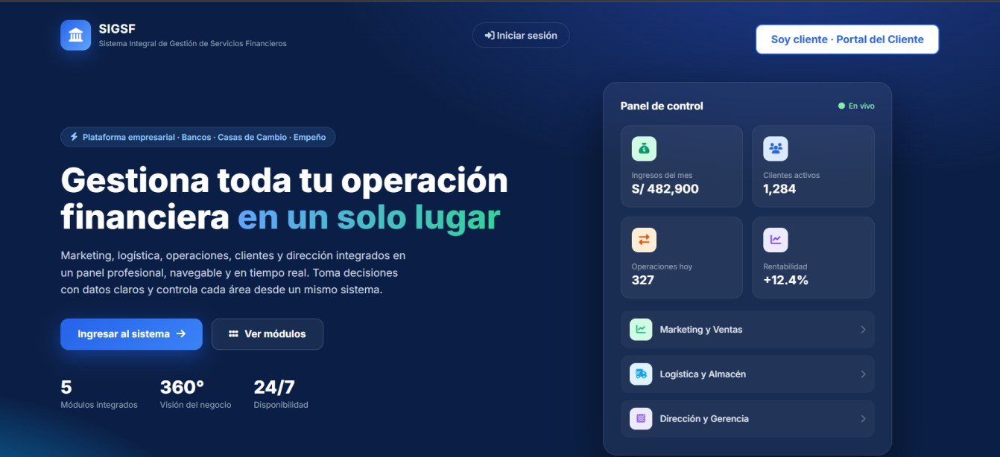

*Figura 2. Pantalla de bienvenida de SIGSF.*

## 1.2. REQUISITOS MÍNIMOS.

Hardware recomendado para ejecutar el servidor y la base de datos:

- Procesador de doble núcleo (Intel o AMD), 2 GHz o superior.
- 4 GB de memoria RAM como mínimo (8 GB recomendado si PostgreSQL corre en el mismo equipo que el servidor).
- 500 MB de espacio libre en disco para el proyecto, la base de datos, los respaldos, los registros (logs) y los reportes generados.
- Conexión de red local: el sistema se ejecuta en localhost y no requiere internet, salvo para el asistente de voz del navegador y para sincronizar el repositorio en GitHub.

Software necesario:

- JDK 17 o superior.
- PostgreSQL, junto con pgAdmin 4 (se recomienda incluir *pg_dump* en el PATH para generar respaldos completos).
- Driver JDBC oficial de PostgreSQL (postgresql-42.x.jar).
- Librerías de registro SLF4J 2.0.16 y Logback 1.5.12 (se descargan con scripts\descargar_librerias.bat).
- NetBeans IDE, ya que el proyecto está configurado como proyecto Ant/NetBeans (incluye build.xml y la carpeta nbproject/).
- **Git 2.x** (Git for Windows), necesario desde la versión 5.0 para clonar el repositorio y para que el sistema muestre su versión.
- Navegador web moderno con soporte de JavaScript; se recomienda Google Chrome, por su mejor compatibilidad con las Web Speech API que usa el asistente de voz.

## 1.3. PUNTO DE INICIO PARA LA INSTALACIÓN Y CONFIGURACIÓN.

Desde la versión 5.0 el punto de partida es el **repositorio Git del proyecto** en GitHub (https://github.com/MiguelWaa/SistemaFinanciero). También se entrega una copia comprimida (SistemaFinanciero.zip) y el archivo SIGSF.bundle, que contiene el mismo repositorio con todas sus ramas y etiquetas (se restaura con *git clone SIGSF.bundle SistemaFinanciero*). El repositorio incluye el código fuente, el frontend completo, los scripts de base de datos, las pruebas automatizadas, la carpeta docs/ con la documentación técnica, y dos guías de referencia: README.md (documentación técnica) e INSTALAR_LEEME.txt (guía paso a paso para quien instala el sistema por primera vez).

La instalación consta de cuatro partes, en este orden: obtener el proyecto y activar los hooks de Git, preparar la base de datos en PostgreSQL, colocar las librerías y configurar la conexión, y ejecutar el proyecto desde NetBeans.

## 1.4. INSTALACIÓN.

- **Paso 1 – Obtener el proyecto:** abrir una terminal (Git Bash) y ejecutar *git clone https://github.com/MiguelWaa/SistemaFinanciero.git*. Si recibió el .zip, descomprímalo conservando la carpeta oculta .git. Se recomienda una ruta corta, por ejemplo C:\SIGSF\\
- **Paso 2 – Activar los hooks del equipo:** ejecutar scripts\git\instalar_hooks.bat (en Linux/macOS, scripts/git/instalar_hooks.sh). Esto activa las validaciones *pre-commit* y *commit-msg* descritas en el capítulo 4.
- **Paso 3 – Base de datos:** crear en pgAdmin 4 una base de datos llamada **SistemaFinanciero** (con S y F mayúsculas).
- **Paso 4 – Cargar tablas y datos:** en el Query Tool de esa base, ejecutar **en este orden**: db/schema.sql (crea las tablas), db/datos_ejemplo.sql (datos de prueba), db/portal_cliente.sql (accesos del Portal del Cliente), db/seguridad.sql (auditoría inmutable, restricciones, índices y rol sigsf_app) y db/version_esquema.sql (historial de versiones del esquema). Este último script es idempotente: puede ejecutarse varias veces.
- **Paso 5 – Librerías:** ejecutar scripts\descargar_librerias.bat (descarga SLF4J y Logback a la carpeta lib/). Copiar el driver postgresql-42.x.jar dentro de lib/ y renombrarlo a postgresql.jar (o agregarlo desde NetBeans en Propiedades del proyecto → Librerías).
- **Paso 6 – Configurar la conexión:** copiar db.properties.ejemplo con el nombre **db.properties** y escribir la contraseña real de PostgreSQL. Desde la versión 5.0 este archivo ya no se versiona en Git (contiene credenciales); si no existe, el sistema usa los valores del archivo de ejemplo.
- **Paso 7 – Ejecutar:** abrir el proyecto en NetBeans (Archivo → Abrir Proyecto → carpeta SistemaFinanciero) y ejecutar con F6 (Run); esto lanza la clase ServerMain.
- **Paso 8 – Verificar:** en la consola de salida deben aparecer los mensajes “Conexión a PostgreSQL correcta”, “Versión del esquema de la base: 5.0.0 (la esperada por el código)” y “SIGSF - Servidor iniciado”. Luego abra el navegador en http://localhost:8091. En el menú lateral, la opción Control de versiones debe mostrar v5.0.1.

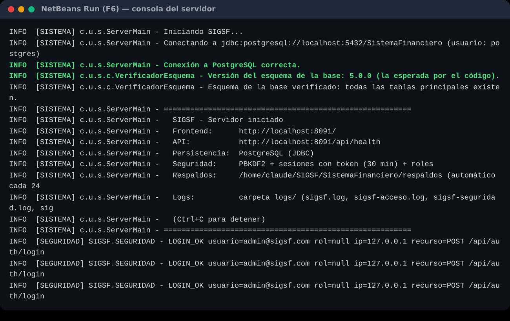

*Figura 4. Consola de NetBeans tras iniciar el servidor correctamente (versión 5.0.1).*

## 1.5. CONFIGURACIÓN.

Toda la configuración se realiza en el archivo db.properties, ubicado en la raíz del proyecto, y se lee al arrancar el servidor sin necesidad de recompilar el código. Sus campos son:

| Clave                                              | Valor por defecto   | Descripción                                                                                                                       |
|----------------------------------------------------|---------------------|-----------------------------------------------------------------------------------------------------------------------------------|
| persistencia                                       | postgresql          | postgresql = base real; memoria = modo demostración sin base de datos (los datos se pierden al cerrar).                           |
| db.host / db.port                                  | localhost / 5432    | Dirección y puerto del servidor PostgreSQL.                                                                                       |
| db.name                                            | SistemaFinanciero   | Nombre de la base de datos.                                                                                                       |
| db.user / db.password                              | postgres / postgres | Credenciales de PostgreSQL. Se recomienda usar el rol *sigsf_app* (mínimo privilegio) y la variable de entorno SIGSF_DB_PASSWORD. |
| server.port                                        | 8091                | Puerto en el que SIGSF publica la API y el frontend; si está ocupado puede cambiarse (por ejemplo a 8092).                        |
| web.dir                                            | web                 | Carpeta del frontend, relativa a la carpeta del proyecto.                                                                         |
| seguridad.sesion.minutos                           | 30                  | Minutos de inactividad antes de que expire la sesión.                                                                             |
| seguridad.intentos.max / seguridad.bloqueo.minutos | 5 / 5               | Intentos fallidos permitidos y minutos de bloqueo de la cuenta.                                                                   |
| seguridad.pbkdf2.iteraciones                       | 120000              | Costo del cifrado de contraseñas.                                                                                                 |
| backup.dir                                         | respaldos           | Carpeta donde se guardan los respaldos.                                                                                           |
| backup.pgdump                                      | auto                | Ruta de pg_dump (auto = PATH y carpetas de instalación de PostgreSQL).                                                            |
| backup.retener                                     | 10                  | Cantidad de respaldos que se conservan.                                                                                           |
| backup.automatico.horas                            | 24                  | Frecuencia del respaldo automático (0 = desactivado).                                                                             |

Desde la propia aplicación, el módulo Configuración del panel administrativo permite mantener los tipos de cambio vigentes (moneda origen/destino, compra, venta, vigencia) y consultar el estado del servidor, sin necesidad de editar archivos ni volver a compilar el proyecto.

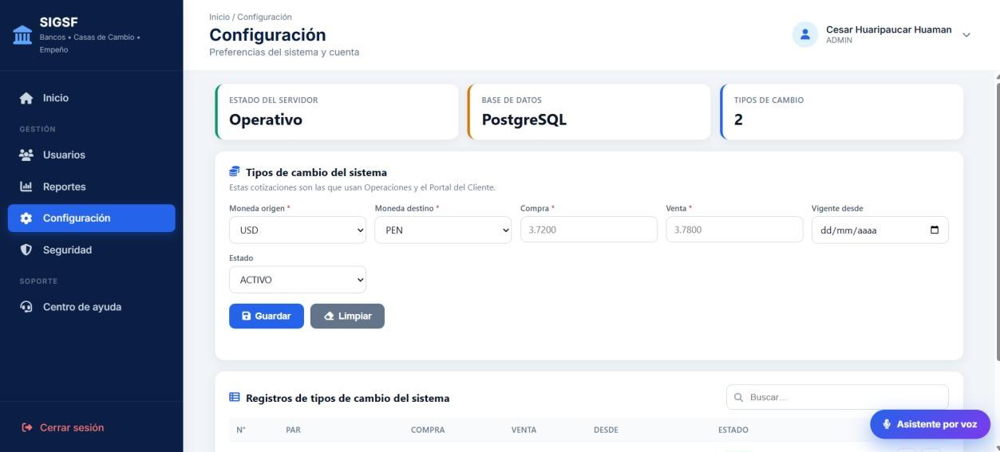

*Figura 6. Módulo Configuración: tipos de cambio.*

## 1.6. OTROS.

- **Usuarios de prueba del personal:** admin@sigsf.com / admin123 (rol ADMIN), lucia.ramos@sigsf.com / lucia123 (rol CAJERO) y jorge.torres@sigsf.com / jorge123 (rol ANALISTA). Las contraseñas se guardan cifradas con PBKDF2-HMAC-SHA256 con sal (las claves antiguas en SHA-256 se convierten solas en el primer inicio de sesión). Cambie estas claves antes de usar el sistema con datos reales.
- **Acceso de prueba al Portal del Cliente:** documento 70000001, contraseña 70000001. Los clientes que ya existían usan su número de documento como clave inicial; también se puede crear una cuenta nueva desde “Crear cuenta”.
- **Seguridad de la sesión:** la sesión se identifica con un token que expira tras 30 minutos de inactividad y se revoca al cerrar sesión. Tras 5 intentos fallidos la cuenta se bloquea 5 minutos. Si no hay sesión, cualquier pantalla redirige al inicio de sesión.
- **Importación y exportación:** la mayoría de los módulos permiten descargar su información en Excel (.xlsx), CSV o JSON, e importar datos desde CSV o Excel con vista previa (ver apartado 3.4).
- **Asistente por voz y Centro de Ayuda:** el panel administrativo incluye un asistente que escucha comandos de voz y responde en voz alta (Web Speech API del navegador) para llevar al usuario directamente a cada módulo o trámite; el Centro de Ayuda agrega además un chat con preguntas frecuentes y contacto de soporte.
- **Registros (logs):** el servidor escribe archivos en la carpeta logs/ (general, acceso, seguridad, errores y uno por área de negocio). Nunca registran contraseñas ni tokens.
- **Manejo de errores:** si el servidor arranca pero no logra conectarse a PostgreSQL, el frontend igual se muestra y cada llamada a la API informa el error con claridad en pantalla, en lugar de dejar de funcionar por completo. Los errores internos muestran solo un código de referencia; el detalle queda en la consola.

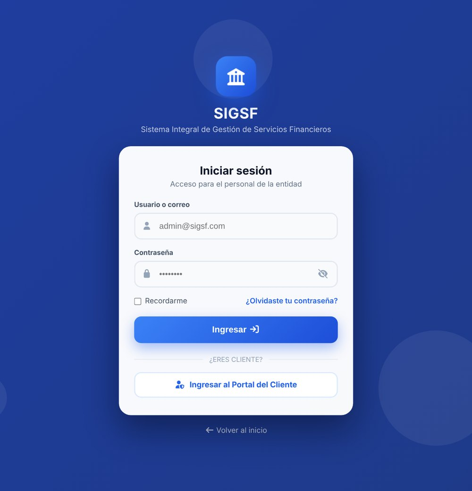

*Figura 8. Pantalla de inicio de sesión del personal.*

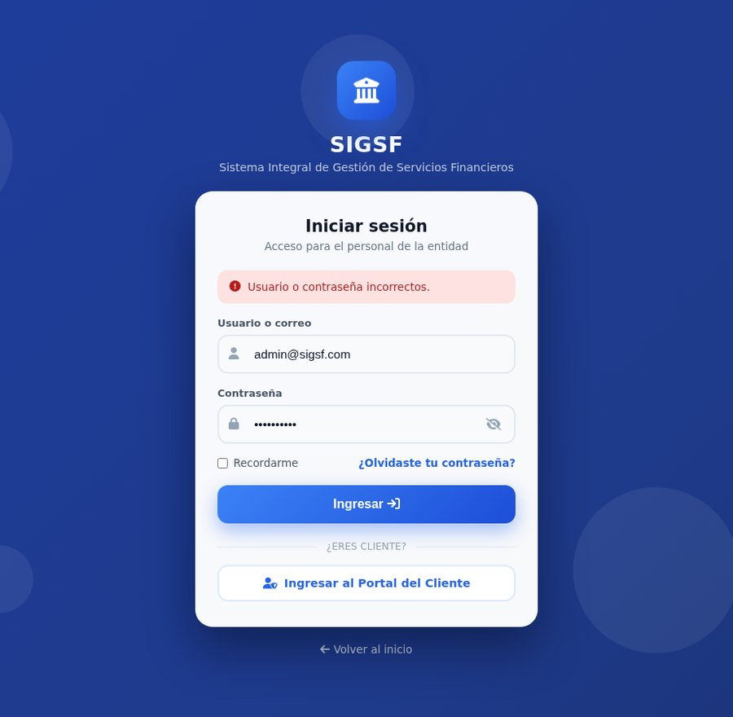

*Figura 10. Mensaje ante credenciales incorrectas: no revela si el usuario existe.*

# 2. MÓDULO DE USUARIO ESTÁNDAR

En SIGSF, el “usuario estándar” corresponde al cliente que se atiende a través del Portal del Cliente (portal.html y portal-inicio.html), la parte pública del sistema. Este portal no maneja un catálogo de productos ni un carrito de compras en el sentido tradicional: en su lugar, el cliente selecciona el trámite financiero que necesita (cambio de moneda, préstamo o empeño), lo envía como solicitud y hace seguimiento de su estado. Los apartados siguientes describen esa experiencia usando la misma estructura del formato institucional del manual. Se ingresa desde la pantalla de bienvenida con el botón “Soy cliente · Portal del Cliente”, o directamente en http://localhost:8091/portal.html.

## 2.1. ESTRUCTURA VISUAL

### 2.1.1. PANEL DERECHO – PANEL DE INFORMACIÓN.

Es el bloque de bienvenida y resumen personal, ubicado en la cabecera de portal-inicio.html. Muestra el nombre del cliente y un resumen calculado con sus datos reales: número de trámites realizados, trámites en revisión, trámites aprobados y el monto total solicitado. Este resumen se recalcula cada vez que el cliente inicia sesión o registra un nuevo trámite.

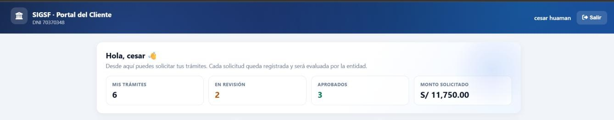

*Figura 12. Panel de información del Portal del Cliente.*

### 2.1.2. PANEL IZQUIERDO – PANEL DE TAREAS.

Presenta las tarjetas de trámite disponibles para el cliente: Cambio de moneda, Préstamo, Empeño, Mis datos e Historial de solicitudes. Cada tarjeta se eleva ligeramente al pasar el mouse y, al pulsarla, abre el formulario correspondiente.

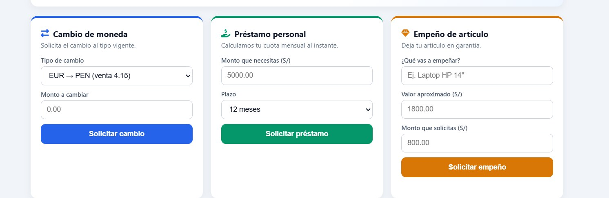

*Figura 14. Panel de tareas del Portal del Cliente.*

### 2.1.3. PANEL INFERIOR.

Esta sección muestra el bloque “Mis datos de contacto”, con los campos Teléfono, Correo y Dirección ya cargados con la información del cliente y un botón Actualizar para guardar los cambios; y, debajo, la tabla “Mis trámites”, que lista cada solicitud con las columnas N°, Trámite, Monto, Estado y Fecha, donde el Estado aparece como una etiqueta de color (COMPLETADA en verde, PENDIENTE en ámbar y ANULADA en morado).

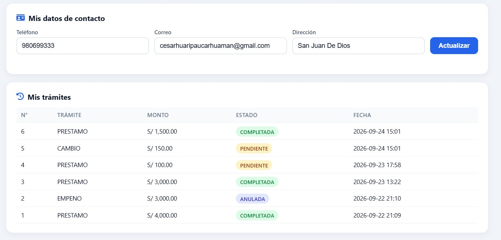

*Figura 16. Datos de contacto y mis trámites del cliente en el Portal.*

## 2.2. FUNCIONALIDADES

### 2.2.1. SELECCIONAR PRODUCTOS.

En lugar de productos, el cliente elige uno de los tres trámites que ofrece el portal:

- **Cambio de moneda:** selecciona el tipo de cambio vigente (moneda origen/destino) e ingresa el monto; el sistema calcula al instante cuánto recibirá, usando el tipo de cambio de venta vigente.
- **Préstamo:** ingresa el monto solicitado y el plazo en meses; el sistema calcula la cuota mensual aplicando interés simple.
- **Empeño:** describe el artículo que dejará en garantía, su valor estimado, el monto que solicita y el plazo en días.

### 2.2.2. AGREGAR, MODIFICAR, ELIMINAR PRODUCTOS.

El cliente no administra un catálogo de productos, sino su propia cuenta:

- **Agregar:** crea su cuenta desde la pestaña “Crear cuenta”, indicando tipo y número de documento, nombres, apellidos, teléfono, correo, dirección y una contraseña de **al menos 6 caracteres**.

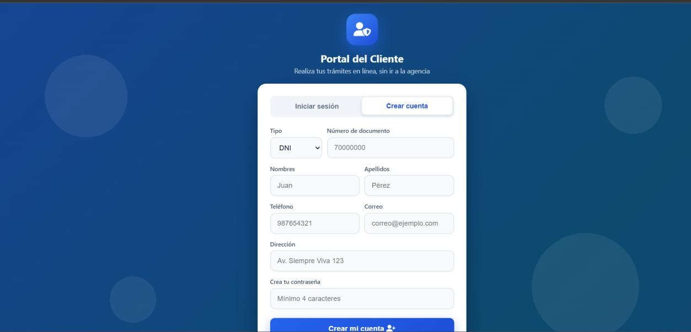

*Figura 18. Registro de un nuevo cliente desde el Portal.*

- **Modificar:** actualiza sus datos de contacto (teléfono, correo, dirección) desde la opción “Mis datos”.

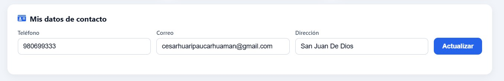

*Figura 20. Actualización de datos de contacto del cliente.*

- **Eliminar:** el portal no permite que el cliente elimine su cuenta ni sus solicitudes; únicamente el personal, desde la Bandeja de Solicitudes del sistema interno, puede aprobar o rechazar un trámite, o activar y bloquear el acceso de una cuenta. Por seguridad, un cliente solo puede ver y modificar su propia información.

### 2.2.3. CARRITO DE COMPRAS.

Como el portal no vende productos, esta sección equivale al historial de trámites: cada solicitud que el cliente envía queda registrada con estado PENDIENTE hasta que el personal la revisa. Desde “Historial” el cliente consulta todas sus solicitudes (cambios, préstamos y empeños) junto con el estado actual de cada una: pendiente, completada o anulada.

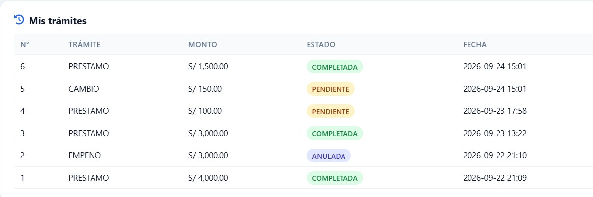

*Figura 22. Historial de trámites del cliente en el Portal.*

### 2.2.4. PAGOS.

Desde la versión 5.2 el Portal del Cliente permite **pagar con Yape, Plin o Tunki escaneando un código QR**. El sistema no usa una pasarela de tarjetas: el cliente paga desde su app y registra el número de operación, y la caja verifica el abono antes de confirmarlo (ver el apartado 3.2.6).

**Cálculo automático de los trámites.** Antes de enviar una solicitud, el portal calcula los montos. **El servidor recalcula siempre estos valores**: cualquier total o tasa alterado desde el navegador es ignorado.

- **Cambio de moneda:** total a recibir = monto ingresado × tipo de cambio de venta vigente.
- **Préstamo (cuota mensual):** se calcula con interés simple sobre el plazo, con una tasa por defecto de 15 % cuando el cliente no la especifica. La cuota se redondea al centavo más cercano (el intento de truncarla fue revertido en la versión 5.0 porque descuadraba el saldo).
- **Empeño:** el saldo pendiente inicial es igual al monto del préstamo solicitado, con una tasa por defecto de 10 % y un plazo por defecto de 30 días si el cliente no lo indica.

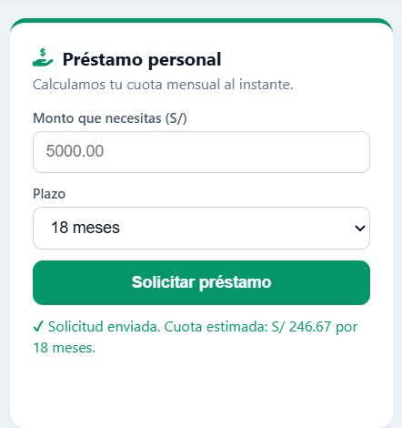

*Figura 24. Cálculo automático mostrado al cliente.*

**Cómo pagar con QR.** En el menú del portal elija **Pagar con QR**. El asistente tiene cuatro pasos:

1. **Qué pagas.** Elija el trámite (cuota de préstamo, rescate de empeño, cambio de moneda u otro pago), confirme el monto —no puede superar lo que se debe— y escoja la billetera: Yape, Plin o Tunki.
2. **Escanea y paga.** El portal muestra el QR de cobro con el monto exacto, el número de la empresa, el titular y un código de referencia (por ejemplo C2-OP2) que conviene escribir en el mensaje del pago. Abra su app, escanee el QR o pague al número indicado.
3. **Registra tu pago.** Escriba el **número de operación** que le muestra su app (de 4 a 30 letras, números o guiones), el celular desde el que pagó y, si desea, adjunte la captura de la constancia (PNG, JPG o WEBP de hasta 500 KB).
4. **Listo.** El pago queda en estado **Por verificar** con un código `PG-000065`; el cliente puede ver su constancia o hacer otro pago.

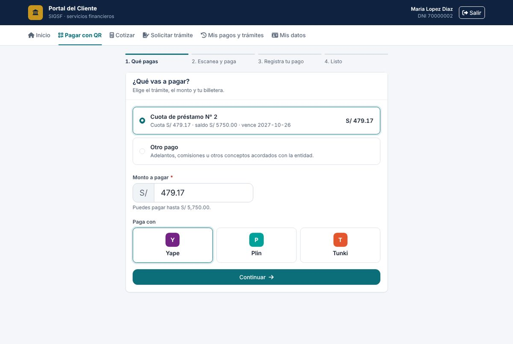

*Figura 26. Pagar con QR, paso 1: elegir qué pagar, el monto y la billetera.*

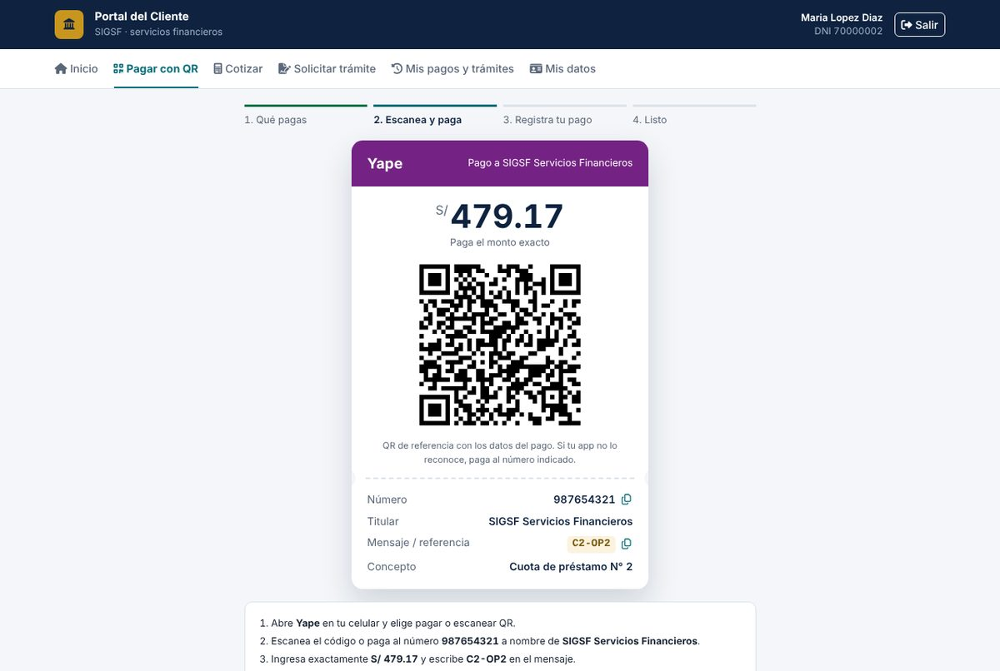

*Figura 28. Pagar con QR, paso 2: código QR con el monto, el titular y la referencia.*

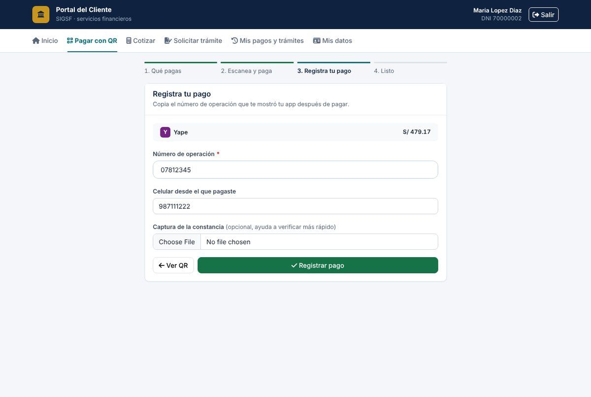

*Figura 30. Pagar con QR, paso 3: número de operación y constancia.*

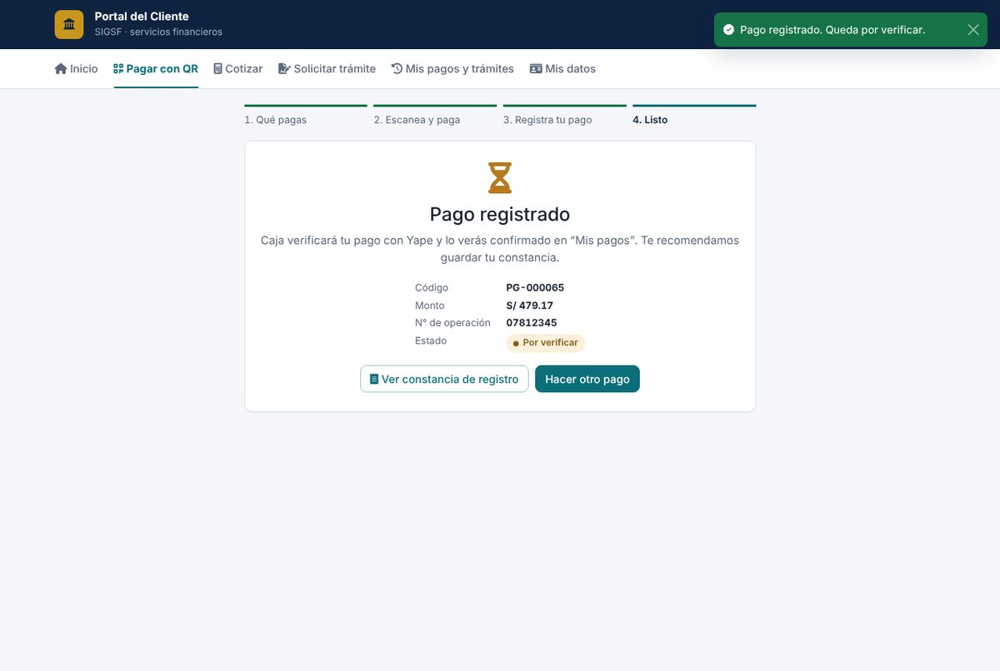

*Figura 32. Pago registrado: queda por verificar.*

**Estados de un pago.** *Por verificar* (esperando a la caja), *Confirmado* (se descontó de la deuda y se emitió el comprobante `RC-…`) y *Rechazado* (con el motivo, visible para el cliente en **Mis pagos**).

**Reglas que aplica el sistema.**

- Un número de operación no se puede repetir con la misma billetera: «Ese número de operación de YAPE ya fue registrado.»
- No se puede pagar más de lo pendiente, descontando lo que ya está por verificar.
- Solo se pagan trámites propios y activos.
- Si la empresa aún no subió su QR real, el portal muestra un QR de referencia con los datos del pago; en ese caso el cliente paga al número indicado.

### 2.2.5. MAPAS, CHAT U OTROS.

El Portal del Cliente no incluye mapas de agencias ni un chat propio; esas funciones (asistente por voz y chat de ayuda) están disponibles únicamente en el sistema interno, y se describen en el apartado 3.2.5 de este manual.

# 3. MÓDULO DE USUARIO ADMINISTRACIÓN

En SIGSF, el “usuario administración” corresponde al personal interno que ingresa por login.html con su correo y contraseña, y accede al panel de index.html según su rol (Administrador, Supervisor, Cajero o Analista). Desde ese panel se gestionan todos los módulos operativos del sistema. Para ingresar: abra http://localhost:8091, pulse “Iniciar sesión”, escriba su correo y contraseña y pulse “Ingresar”. Si olvidó su contraseña, solicite al Administrador que la restablezca desde Usuarios.

## 3.1. ESTRUCTURA VISUAL.

### 3.1.1. PANEL DERECHO – PANEL DE INFORMACIÓN.

Es la franja de indicadores (KPI) de la parte superior del panel principal (index.html): ingresos del mes, clientes activos, operaciones de hoy, préstamos colocados, expedientes pendientes y solicitudes pendientes, entre otros. Cada indicador se calcula de forma independiente (DashboardService), de modo que si una consulta falla, el resto de las tarjetas se sigue mostrando en vez de dejar todo el panel en blanco. Debajo de las tarjetas se muestra la sección “Últimos clientes registrados” con los clientes más recientes (avatar, documento, contacto, estado y fecha). En la esquina superior derecha aparece el nombre y el rol del usuario con sesión iniciada.

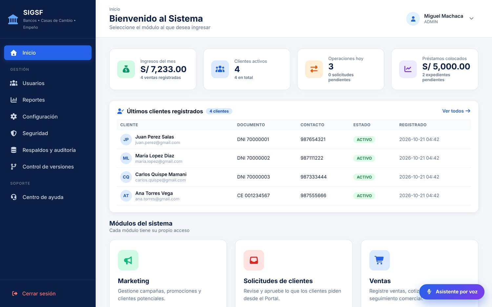

*Figura 34. Panel principal del sistema interno con indicadores y últimos clientes.*

### 3.1.2. PANEL IZQUIERDO – PANEL DE TAREAS.

Es el menú lateral de navegación, con acceso a: Inicio, Usuarios, Reportes, Configuración, Seguridad, Respaldos y auditoría, Control de versiones, Centro de ayuda y Cerrar sesión. Cada opción abre su propia pantalla de gestión. Las opciones administrativas (Usuarios, Respaldos y auditoría, Control de versiones) solo funcionan para el rol Administrador; los demás roles reciben un mensaje de acceso denegado.

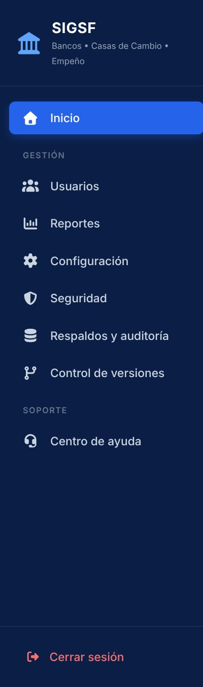

*Figura 36. Menú lateral del sistema interno.*

### 3.1.3. PANEL INFERIOR.

Debajo de los indicadores, la sección “Módulos del sistema” muestra una tarjeta por módulo, cada una con su botón “Ingresar”: Marketing, Solicitudes de clientes (con el contador de solicitudes pendientes), Ventas, Logística, Almacén, Producción, Operaciones Financieras, Dirección, Gerencia General, Clientes y Servicios Financieros y, desde la versión 5.0, **Respaldos y Auditoría** y **Control de versiones**. Al pie del panel se muestra la versión en ejecución (por ejemplo “SIGSF v5.0.1 · rama main · commit 7ff4ebb · esquema BD v5.0.0”).

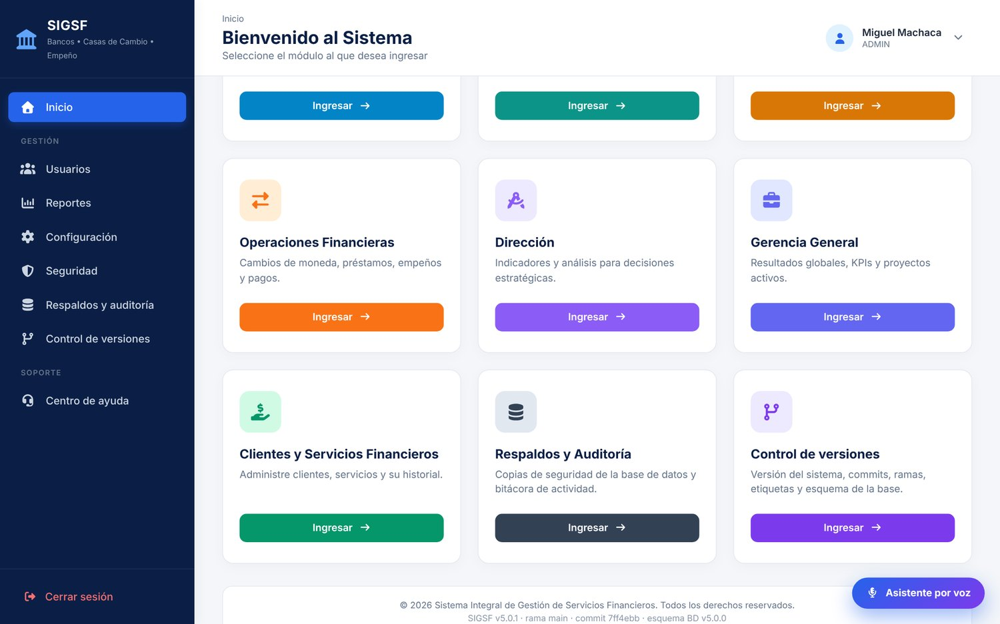

*Figura 38. Tarjetas de módulos y pie con la versión del sistema.*

## 3.2. FUNCIONALIDADES.

Todas las pantallas de gestión comparten el mismo motor de trabajo (sigsf-modulo.css y sigsf-crud.js): un panel de registro con los campos del formulario, indicadores en vivo propios del módulo, un buscador, una tabla con los registros existentes y, en cada fila, los botones Editar y Eliminar; los campos obligatorios (marcados con \*) se validan antes de guardar y los errores se muestran con un mensaje claro. A continuación se detalla lo que gestiona cada módulo.

### 3.2.1. MANTENIMIENTO DE USUARIOS.

Pantalla Usuarios, sobre la tabla usuario (pestañas Usuarios y Roles):

- **Gestión de cuentas:** permite listar, crear, editar y eliminar usuarios del personal (nombre, apellido, correo, contraseña, rol y estado).
- **Validaciones:** el correo debe ser único. Las contraseñas deben tener **al menos 8 caracteres e incluir letras y números**. Si no se indica contraseña al crear el usuario, el sistema asigna la temporal “cambiar123”; el hash (PBKDF2) nunca se muestra ni se envía al navegador.
- **Estado inicial:** un usuario recién creado queda en estado PENDIENTE hasta que se activa; solo las cuentas ACTIVAS pueden iniciar sesión.
- **Módulo Seguridad (complementario):** administra los Roles del sistema (ADMIN, SUPERVISOR, CAJERO y ANALISTA, entre otros) y su descripción, y muestra la **matriz de permisos** que determina qué puede hacer cada rol (ver apartado 3.3).

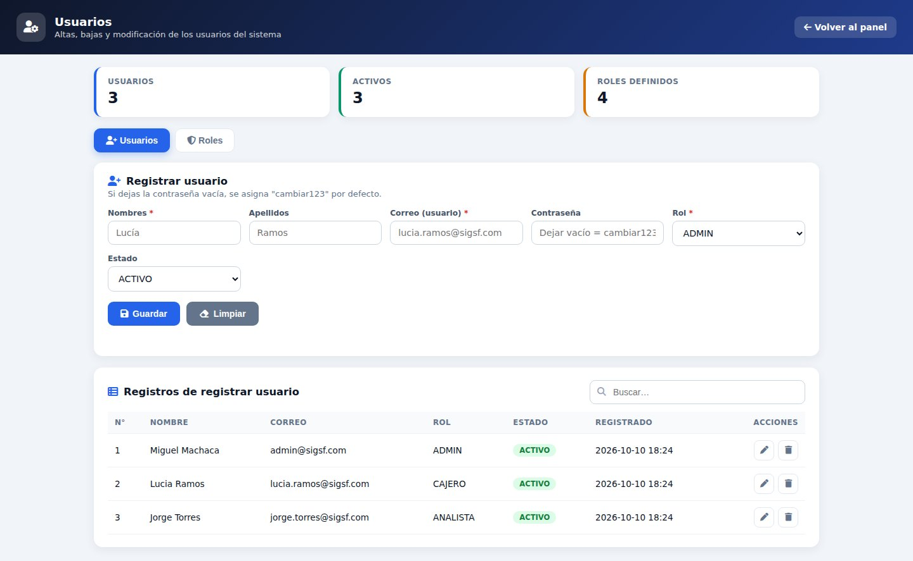

*Figura 40. Módulo Usuarios: gestión del personal.*

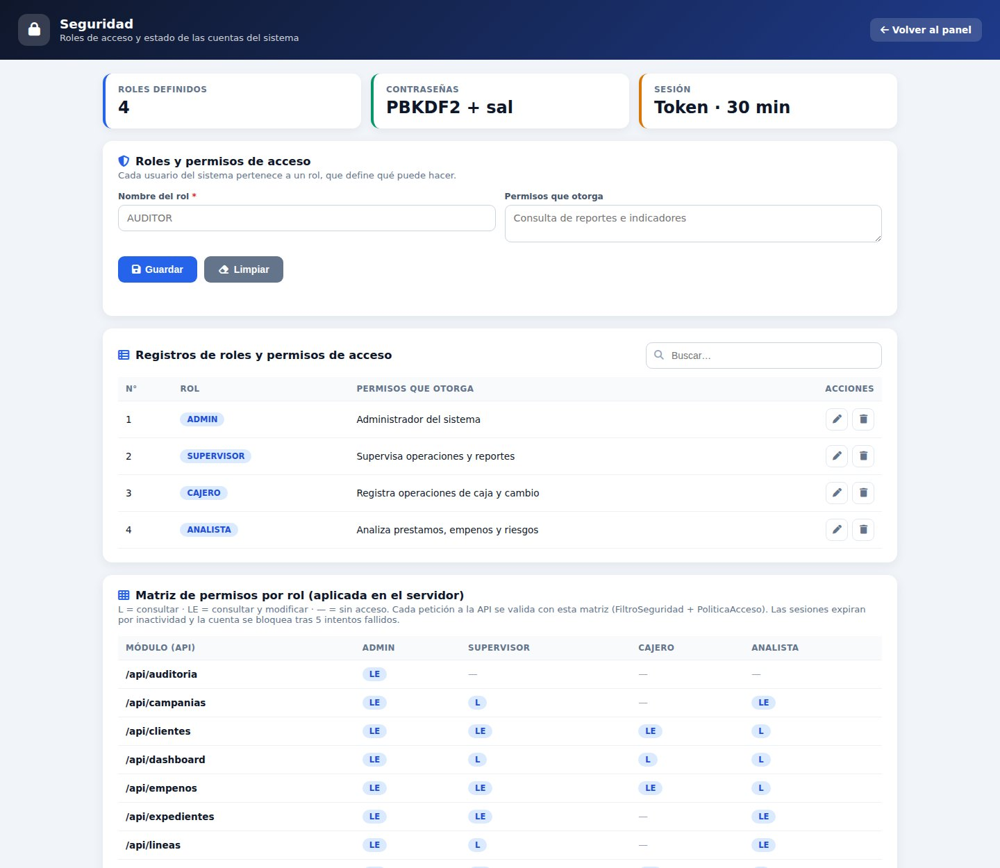

*Figura 42. Módulo Seguridad: roles y matriz de permisos.*

### 3.2.2. MANTENIMIENTO DE PRODUCTOS.

Pantalla Almacén, sobre la tabla producto (con apoyo de inventario y movimiento_inventario):

- **Datos del producto:** registra el código, nombre, descripción, categoría, unidad de medida, stock actual, stock mínimo y estado de cada producto.
- **Alerta de stock bajo:** el sistema resalta en rojo el producto cuando su stock actual llega o baja del stock mínimo definido, y el indicador “Stock bajo” lo contabiliza.
- **Operaciones disponibles:** listar, editar, eliminar y buscar productos; exportar el listado a Excel, CSV o JSON, e importar productos desde CSV o Excel (apartado 3.4).

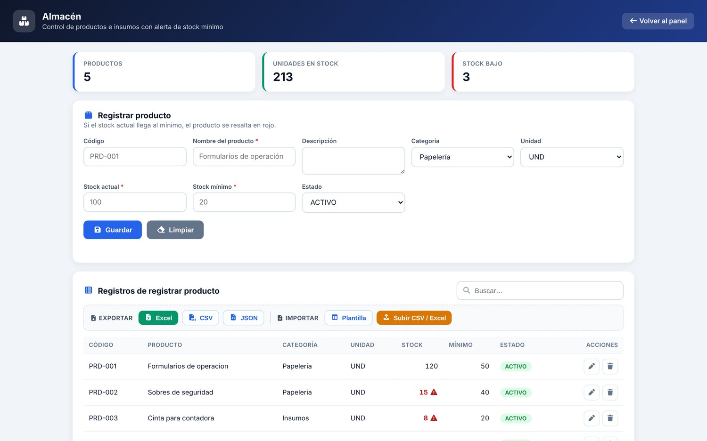

*Figura 44. Módulo Almacén: control de productos e inventario.*

### 3.2.3. MANTENIMIENTO DE PROVEEDORES.

Pantalla Logística, sobre la tabla proveedor (con apoyo de movimiento_logistica):

- **Datos del proveedor:** registra la razón social (obligatoria), RUC, persona de contacto, teléfono, correo, dirección y estado.
- **Operaciones disponibles:** listar, crear, editar, eliminar y buscar proveedores, como apoyo a los módulos de Almacén y Producción. Solo los roles ANALISTA y ADMIN pueden registrarlos o importarlos; el Cajero tiene acceso denegado.

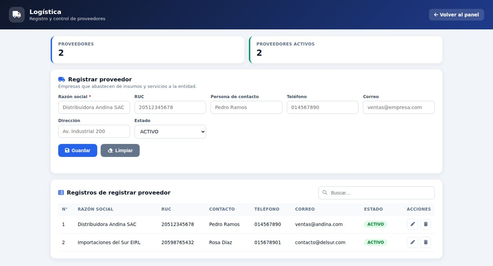

*Figura 46. Módulo Logística: gestión de proveedores.*

### 3.2.4. MANTENIMIENTO DE TRANSACCIONES.

Pantalla Operaciones Financieras, la más amplia del sistema, organizada en pestañas:

- **Operaciones:** registra cambios de moneda (calcula automáticamente el total a recibir con el tipo de cambio vigente, leído de la base de datos) y permite aprobar o anular cada operación.
- **Tipos de cambio:** mantiene las monedas de origen y destino junto con sus tipos de compra y venta vigentes.
- **Préstamos:** registra el monto, la tasa de interés y el plazo en meses; el sistema calcula la cuota mensual y el saldo pendiente con interés simple, y fija automáticamente la fecha de vencimiento.
- **Empeños:** registra el artículo dejado en garantía, el monto prestado, la tasa y el plazo en días; el saldo pendiente inicial es igual al monto prestado.

Los totales, cuotas y saldos **siempre los calcula el servidor**. Por seguridad, las operaciones de dinero (operaciones, ventas, préstamos, empeños y tipos de cambio) no pueden importarse masivamente; solo se exportan. La aprobación la realiza el Supervisor o el Administrador, no el Cajero que registra.

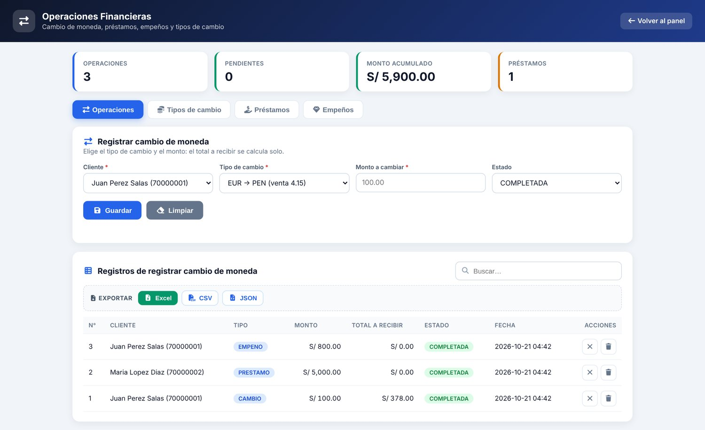

*Figura 48. Módulo Operaciones Financieras.*

Como complemento directo de este apartado, la pantalla Ventas (tabla venta) registra y lista las ventas de servicios financieros a los clientes, y permite descargar el detalle en Excel (botón “Descargar Excel” o /api/ventas/excel); cada venta nueva actualiza también el archivo reportes/ventas.xlsx dentro de la carpeta del proyecto. Las ventas no son editables y su fecha y hora las asigna el servidor.

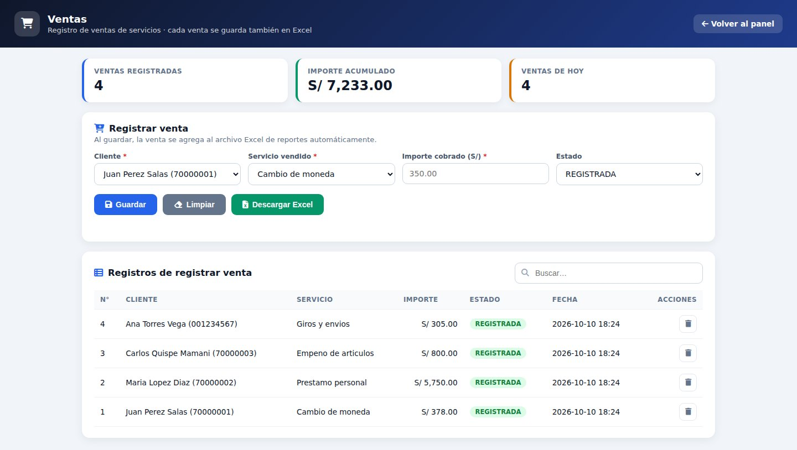

*Figura 50. Módulo Ventas y exportación a Excel.*

### 3.2.5. MANTENIMIENTO DE MAPAS, CHAT U OTROS.

SIGSF no maneja mapas de agencias, pero sí un chat de ayuda y un asistente por voz; además, el sistema interno incluye varios módulos que no encajan en las categorías anteriores. Se agrupan a continuación:

- **Clientes y Servicios Financieros:** mantiene los datos de los clientes (tipo y número de documento, nombres, apellidos, nacimiento, contacto, dirección, estado) y el catálogo de servicios financieros que ofrece la entidad, organizados en dos pestañas.
- **Marketing:** administra Prospectos (clientes potenciales, con su origen y estado) y Campañas (nombre, fechas, presupuesto, canal), como apoyo a la captación de nuevos clientes.
- **Producción:** mantiene Líneas de producción y Órdenes de producción; una orden se marca automáticamente como TERMINADA cuando su avance llega al 100 %.
- **Dirección y Gerencia General:** gestionan los Expedientes de aprobación (código, área, solicitante, monto, impacto y descripción); Dirección y Gerencia pueden aprobar, observar o rechazar cada expediente, lo que registra la decisión y su fecha de resolución.
- **Reportes:** reúne los indicadores en vivo del sistema y centraliza las descargas en Excel: Ventas, Clientes, Operaciones y Productos.
- **Configuración:** mantiene los tipos de cambio vigentes y muestra el estado del servidor.
- **Bandeja de Solicitudes:** reúne, en dos pestañas, todo lo que un cliente pide desde el Portal del Cliente. En “Solicitudes” el personal ve cada pedido con los datos del cliente y el detalle del trámite (filtros Pendientes, Aprobadas, Rechazadas y Todas), y puede Aprobar (lo que activa automáticamente el préstamo o empeño asociado) o Rechazar; en “Cuentas de clientes” puede Activar o Bloquear el acceso de cada cliente al portal.
- **Centro de ayuda:** chat de preguntas frecuentes y contacto de soporte.
- **Asistente por voz:** disponible en el panel principal (botón “Asistente por voz”); reconoce comandos hablados, por ejemplo “abre Marketing” o “ir a Reportes”, y responde con voz para llevar al usuario directamente al módulo que solicita.

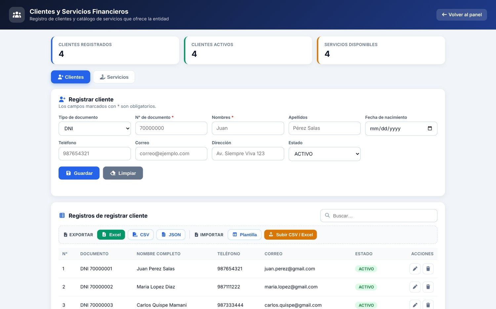

*Figura 52. Módulo Clientes y Servicios Financieros.*

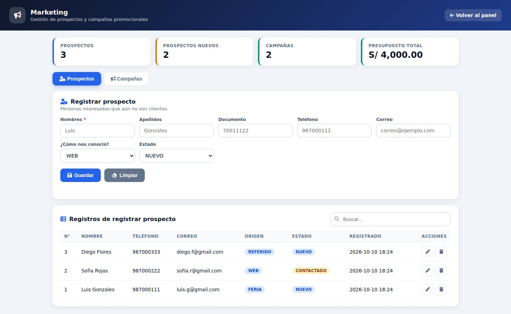

*Figura 54. Módulo Marketing: prospectos y campañas.*

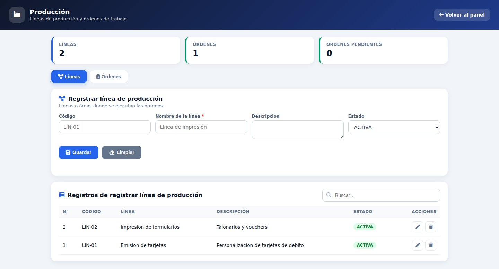

*Figura 56. Módulo Producción: líneas y órdenes.*

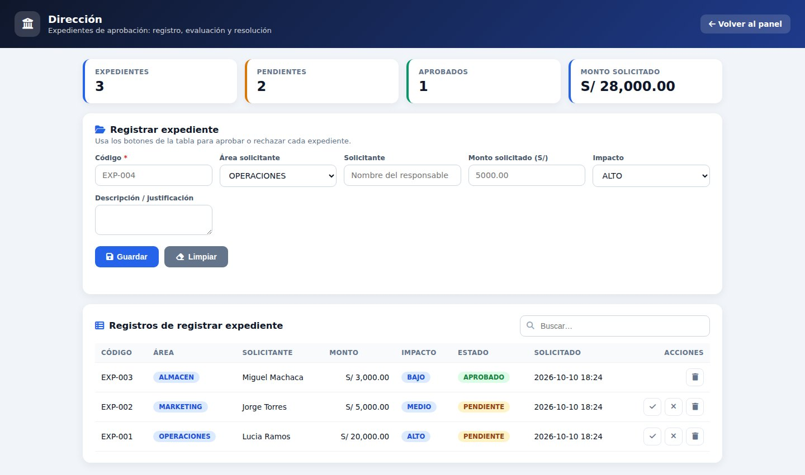

*Figura 58. Módulo Dirección: expedientes de aprobación.*

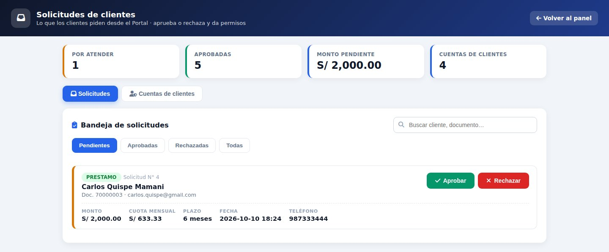

*Figura 60. Bandeja de solicitudes de clientes.*

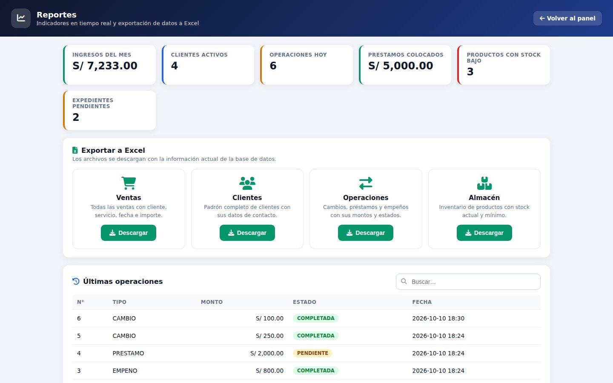

*Figura 62. Módulo Reportes: indicadores y descargas en Excel.*

## 3.3. PERMISOS POR ROL.

Desde la versión 4.0 cada ruta de la API exige una sesión válida y se comprueba el permiso del rol (control de acceso basado en roles). En la tabla, **✔** indica consulta y modificación, “consulta” solo lectura y “—” sin acceso. Cuando un usuario intenta una acción no permitida, el sistema responde con acceso denegado (403) y lo registra en la auditoría.

| Módulo                                                 | ADMIN | SUPERVISOR | CAJERO   | ANALISTA |
|--------------------------------------------------------|-------|------------|----------|----------|
| Usuarios, respaldos, auditoría, control de versiones   | ✔     | —          | —        | —        |
| Clientes, operaciones, préstamos, empeños, solicitudes | ✔     | ✔          | ✔        | consulta |
| Ventas                                                 | ✔     | consulta   | ✔        | consulta |
| Marketing, logística, producción                       | ✔     | consulta   | —        | ✔        |
| Almacén (productos)                                    | ✔     | consulta   | consulta | ✔        |
| Expedientes (Dirección / Gerencia)                     | ✔     | ✔          | —        | ✔        |
| Tipos de cambio y servicios                            | ✔     | consulta   | consulta | consulta |

Un rol nuevo creado desde Seguridad, que no esté en la matriz, recibe únicamente consulta de los módulos no administrativos (principio de mínimo privilegio).

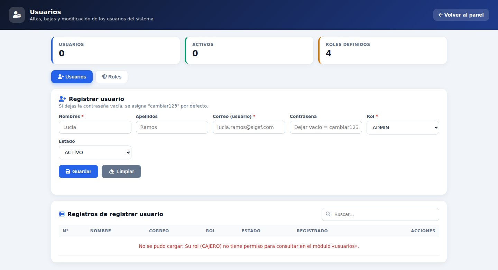

*Figura 64. Un usuario sin permiso recibe un mensaje claro (ejemplo: rol CAJERO en Usuarios).*

## 3.4. IMPORTACIÓN Y EXPORTACIÓN DE FICHEROS.

Quince recursos de las nueve áreas del negocio (entre ellos clientes, prospectos, campañas, ventas, proveedores, productos, líneas y órdenes de producción, operaciones y la bitácora de auditoría) pueden exportarse. Cada tabla de registros muestra una barra con estos botones:

- **Exportar → Excel / CSV / JSON:** descarga el listado completo en el formato elegido. Los textos que empiezan con = + - @ se neutralizan para evitar inyección de fórmulas al abrir el archivo en Excel.
- **Importar → Plantilla:** descarga un archivo de ejemplo con las columnas esperadas.
- **Importar → Subir CSV / Excel:** selecciona un archivo .csv, .txt o .xlsx (máximo 2000 filas; el archivo debe tener las columnas obligatorias). El sistema muestra una **vista previa** con las filas leídas, válidas y con error; al confirmar con “Importar N fila(s)” se cargan solo las válidas y se informa el motivo de cada fila rechazada.

Reglas importantes: las columnas calculadas por el sistema (N°, fechas de registro, totales, estados de aprobación) se ignoran y se informan; las operaciones financieras y las ventas no se importan; importar exige permiso de escritura sobre el módulo y exportar exige permiso de lectura. Cada importación y exportación queda en la auditoría.

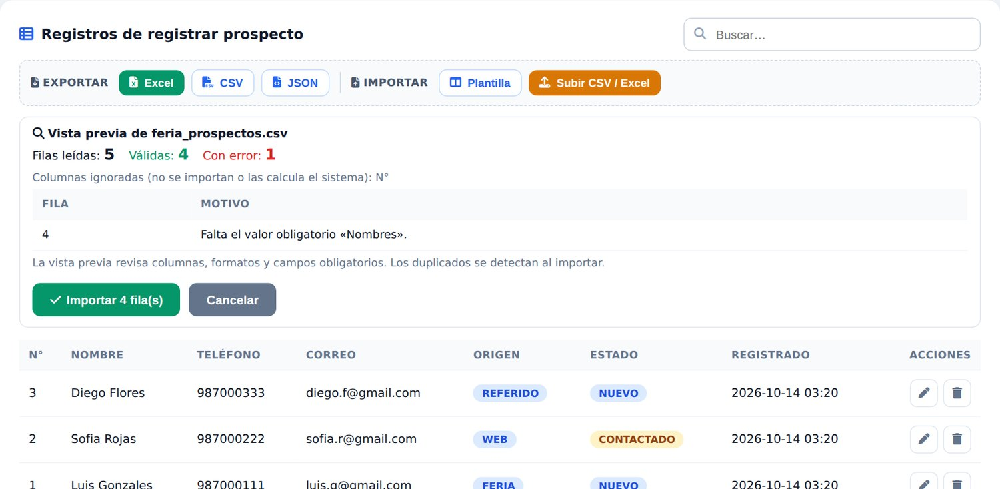

*Figura 66. Vista previa de una importación de prospectos desde CSV.*

## 3.5. RESPALDOS Y AUDITORÍA.

Este módulo, exclusivo del Administrador, tiene dos pestañas y cuatro indicadores en la parte superior (respaldos guardados, último respaldo, logins fallidos y accesos denegados).

- **Respaldos:** el botón “Generar respaldo ahora” crea una copia de la base de datos en la carpeta respaldos/ con el nombre sigsf_AAAAMMDD_HHMMSSmmm_pgdump.sql. El sistema usa *pg_dump* (estructura y datos); si no lo encuentra, genera un script SQL solo con datos mediante JDBC. Además, el servidor genera un respaldo automático cada 24 horas y conserva los últimos 10. En la lista “Respaldos disponibles” se puede descargar o eliminar cada archivo.
- **Restauración:** ejecutar scripts\restaurar_bd.bat con la ruta del archivo, o abrir el .sql en el Query Tool de pgAdmin sobre la base SistemaFinanciero y ejecutarlo (F5). Si el respaldo es de tipo jdbc, ejecute antes db/schema.sql.
- **Auditoría:** bitácora de los últimos 200 eventos con fecha, usuario, rol, acción, recurso, código HTTP e IP. Registra LOGIN_OK, LOGIN_FALLIDO, CREAR, ACTUALIZAR, ELIMINAR, IMPORTAR, EXPORTAR, RESPALDO y ACCESO_DENEGADO. Es inmutable (no se puede editar ni borrar), nunca guarda contraseñas, y se puede buscar y exportar a Excel, CSV o JSON.

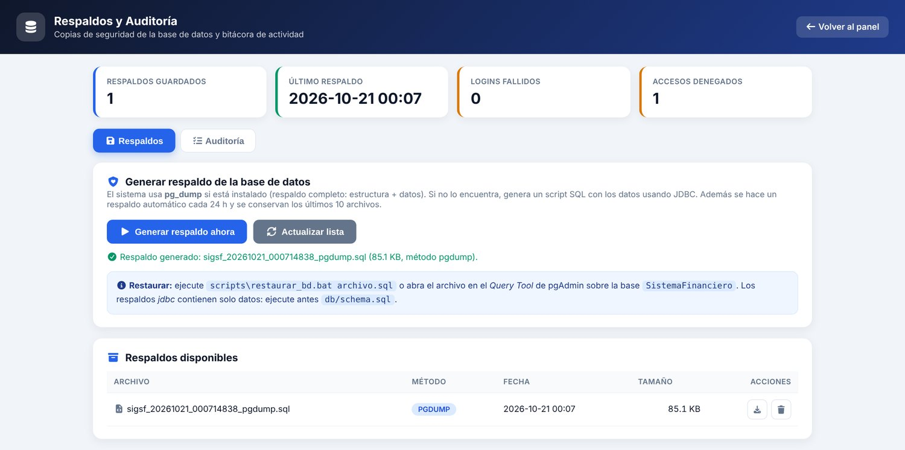

*Figura 68. Pestaña Respaldos: generación y lista de copias de seguridad.*

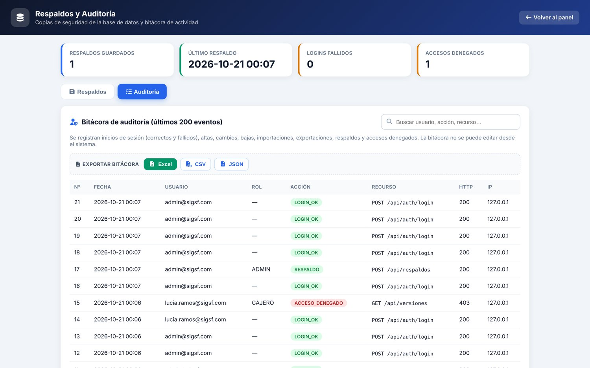

*Figura 70. Pestaña Auditoría: bitácora de eventos.*

## 3.6. CONTROL DE VERSIONES (PANTALLA DEL SISTEMA).

La opción **Control de versiones** del menú lateral muestra, solo para el Administrador, qué versión del sistema está en ejecución y si es compatible con la base de datos. En la parte superior se muestran cuatro indicadores: **Versión del sistema** (por ejemplo v5.0.1), **Rama**, **Commit** y **Esquema BD** (por ejemplo v5.0.0). Una franja verde confirma “Código y base de datos en versiones compatibles”; si el esquema de la base está atrasado se muestra una advertencia. Las pestañas son:

- **Resumen:** versión en ejecución, etiqueta Git más cercana, rama, commit, último mensaje, autor, fecha de compilación y los lanzamientos publicados en el CHANGELOG.
- **Historial de commits:** los últimos commits de todas las ramas, con tipo (Merge, Corrección, Documentación, Rollback…), autor y fecha, y un buscador.
- **Red (network):** gráfico de ramas equivalente a *git log --all --graph*.
- **Ramas y etiquetas:** ramas locales y del remoto origin, y etiquetas v4.0.0, v5.0.0 y v5.0.1.
- **Esquema BD:** historial de versiones de la base (tabla version_esquema): 1.0.0 esquema inicial, 1.1.0 portal del cliente, 2.0.0 seguridad y 5.0.0 control de versiones.

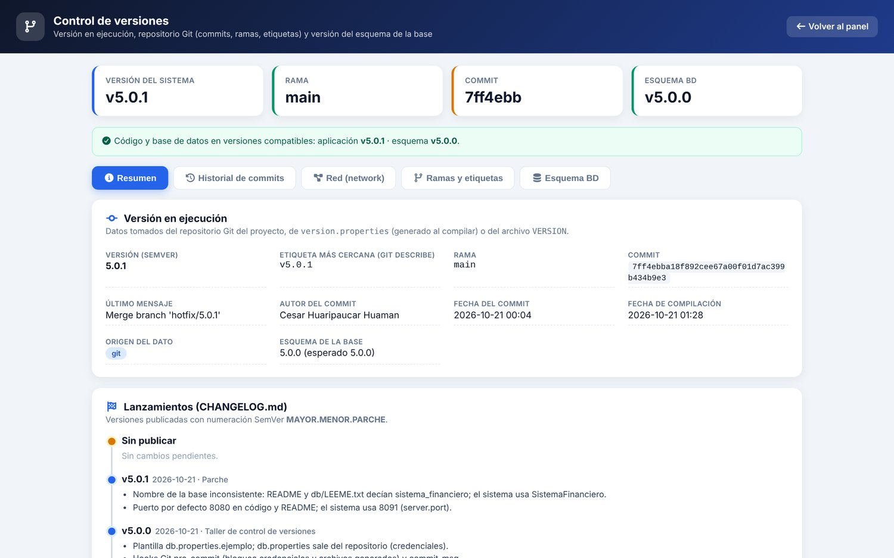

*Figura 72. Control de versiones: pestaña Resumen.*

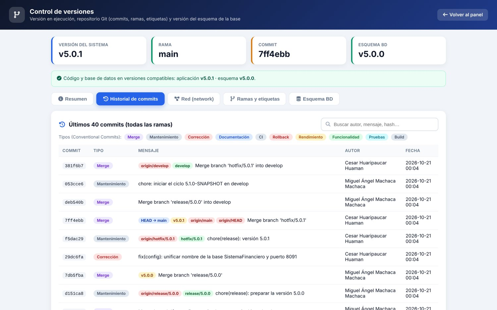

*Figura 74. Control de versiones: historial de commits.*

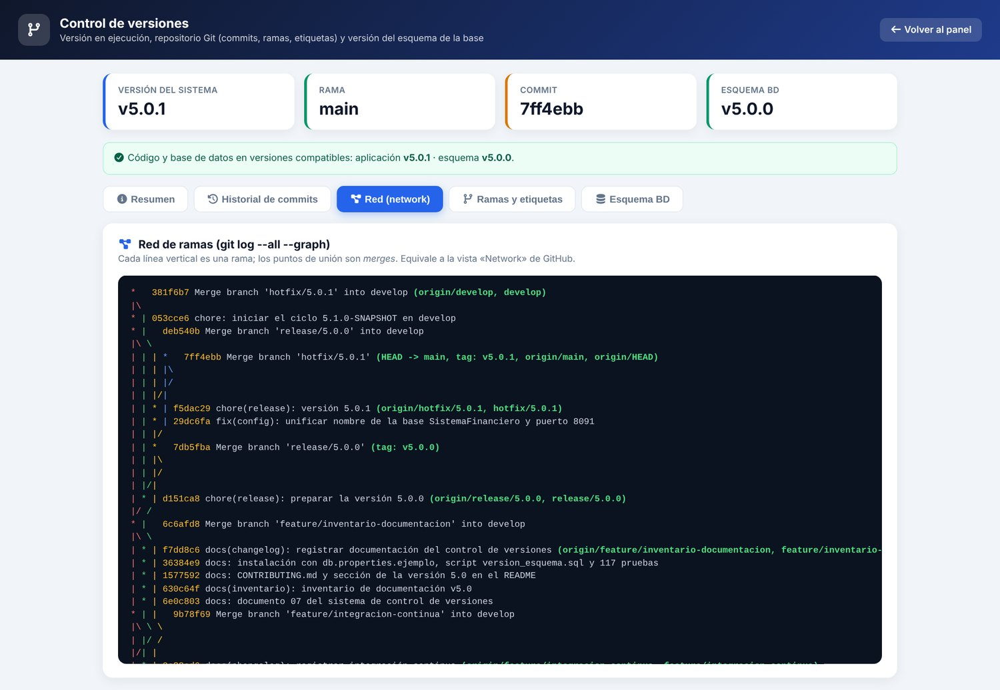

*Figura 76. Control de versiones: red de ramas (network).*

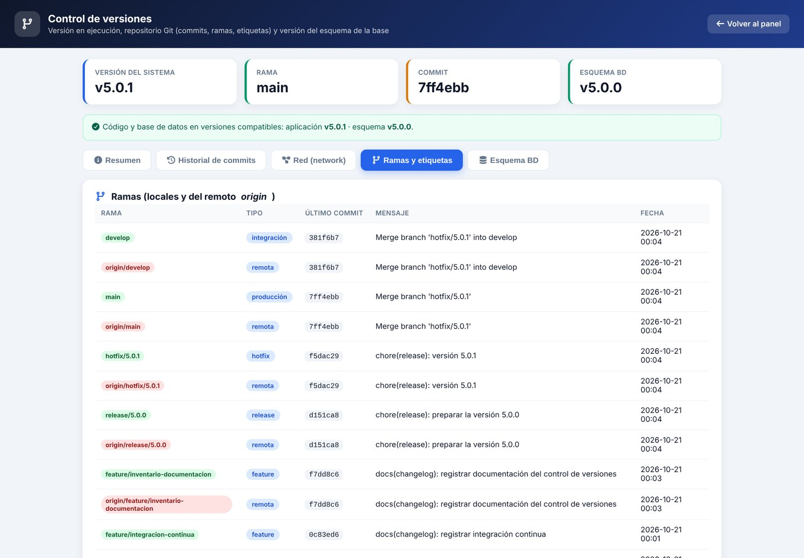

*Figura 78. Control de versiones: ramas y etiquetas.*

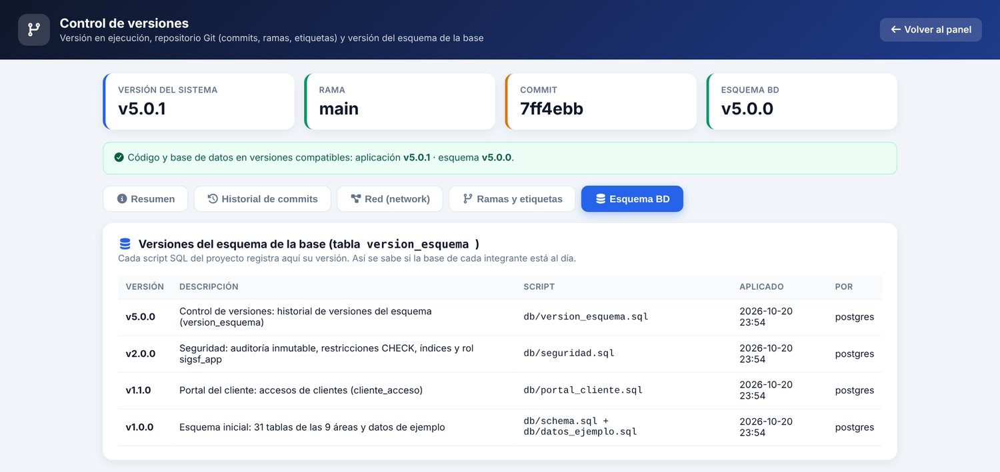

*Figura 80. Control de versiones: versiones del esquema de la base de datos.*

Cuando entra un usuario que no es Administrador (por ejemplo un Cajero), solo ve la pestaña Resumen y el aviso “El historial del repositorio es visible solo para el Administrador”.

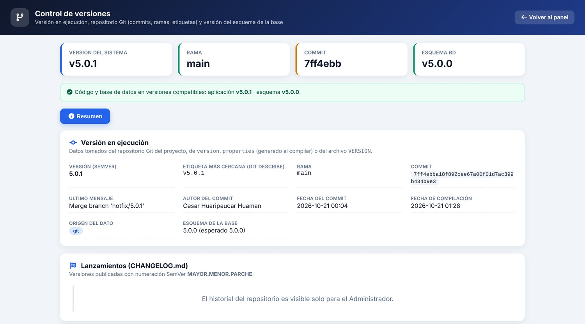

*Figura 82. Vista del Control de versiones para un usuario con rol CAJERO.*

# 4. CONTROL DE VERSIONES DEL PROYECTO (GIT Y GITHUB)

El proyecto es un repositorio Git gestionado con **Git Flow** y publicado en GitHub (https://github.com/MiguelWaa/SistemaFinanciero). Este capítulo resume cómo trabajan los integrantes del equipo; el detalle completo está en docs/07_CONTROL_DE_VERSIONES.md.

## 4.1. RAMAS Y VERSIONES.

| Rama              | Uso                                                                                                                |
|-------------------|--------------------------------------------------------------------------------------------------------------------|
| main              | Producción: cada commit es una versión publicada y etiquetada (v4.0.0, v5.0.0, v5.0.1). Nadie hace commit directo. |
| develop           | Integración del trabajo del equipo; siempre debe compilar y pasar las pruebas.                                     |
| feature/\<tema\>  | Una funcionalidad por rama; nace de develop y se fusiona con merge --no-ff.                                        |
| release/\<x.y.z\> | Preparación de una entrega (número de versión, CHANGELOG).                                                         |
| hotfix/\<x.y.z\>  | Corrección urgente sobre main (por ejemplo hotfix/5.0.1).                                                          |

La numeración sigue SemVer (MAYOR.MENOR.PARCHE) y está en el archivo VERSION; los cambios se anotan en CHANGELOG.md.

## 4.2. FLUJO DE TRABAJO DIARIO.

```bash
git clone https://github.com/MiguelWaa/SistemaFinanciero.git
cd SistemaFinanciero
scripts\git\instalar_hooks.bat          # una sola vez

git switch develop && git pull
git switch -c feature/mi-cambio
git add <archivos>
git commit -m "feat(ventas): exportar ventas a CSV"
git push -u origin feature/mi-cambio     # y abrir un Pull Request hacia develop
```

- **Mensajes de commit:** formato *tipo(ámbito): descripción* con los tipos feat, fix, docs, style, refactor, perf, test, build, ci, chore y revert. El hook commit-msg rechaza los mensajes que no cumplen.
- **Seguridad del repositorio:** db.properties no se sube a Git; el hook pre-commit bloquea credenciales, archivos generados y archivos de más de 5 MB.
- **Deshacer cambios:** en ramas compartidas se usa *git revert* (no reescribe el historial); *git reset* solo sobre commits locales sin publicar.
- **Integración continua:** GitHub Actions compila y ejecuta las 117 pruebas en cada push y Pull Request.

# 5. SOLUCIÓN DE PROBLEMAS FRECUENTES

| Síntoma                                 | Causa probable                                           | Qué hacer                                                                                                       |
|-----------------------------------------|----------------------------------------------------------|-----------------------------------------------------------------------------------------------------------------|
| El servidor no inicia: “puerto en uso”  | Otro programa usa el puerto 8091.                        | Cambiar server.port en db.properties (por ejemplo 8092) y volver a ejecutar.                                    |
| “No se pudo conectar a PostgreSQL”      | Servicio detenido o credenciales incorrectas.            | Iniciar PostgreSQL; revisar db.host, db.name, db.user y db.password. La pantalla igual abre y muestra el error. |
| Aviso de esquema atrasado en la consola | No se ejecutó algún script de db/.                       | Ejecutar los scripts en orden (apartado 1.4); db/version_esquema.sql puede repetirse sin problema.              |
| “Cuenta bloqueada temporalmente”        | 5 intentos fallidos de inicio de sesión.                 | Esperar 5 minutos; si olvidó la clave, pedir al Administrador que la restablezca.                               |
| Se cierra la sesión sola                | 30 minutos sin actividad.                                | Volver a iniciar sesión.                                                                                        |
| “Su rol no tiene permisos…” (403)       | El rol no puede usar ese módulo.                         | Consultar la matriz del apartado 3.3 o pedir un cambio de rol al Administrador.                                 |
| Respaldo con método JDBC y no pgdump    | pg_dump no está en el PATH.                              | Agregar la carpeta bin de PostgreSQL al PATH o indicar backup.pgdump.                                           |
| El asistente por voz no responde        | Navegador sin Web Speech API o sin permiso de micrófono. | Usar Google Chrome y permitir el micrófono.                                                                     |
| El commit es rechazado                  | No cumple el formato o incluye db.properties.            | Usar “tipo(ámbito): descripción”; quitar db.properties del commit.                                              |
